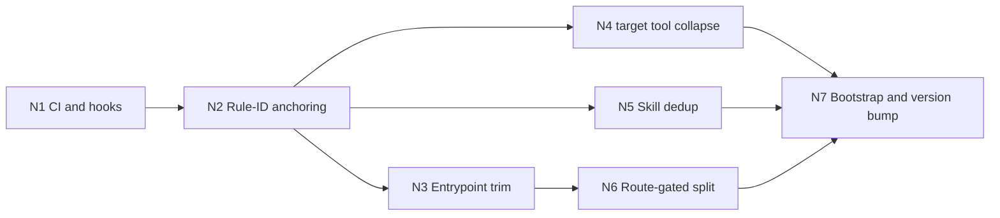

# IP-0001 Context Efficiency And Contract Enforcement

- Workflow contract version: 2.5.0

## Status

In Progress

- Plan revision: 2

The user explicitly approved revision 1 and its full seven-node scope on 2026-09-05, then approved
the revision-2 change to N2's mechanism on the same date. That approval
authorizes implementation of the changes described in this revision only. A material change to
scope, risk, node structure, write ownership, validation strategy, or review coverage increments the
revision, resets status to `Proposed`, and requires explicit approval again.

## Risk Level

High

The plan edits always-loaded safety instructions -- the untrusted-content boundary and the external
tool-data boundary -- across four independent surfaces, for three provider kits that downstream
repositories consume verbatim. A deduplication error silently weakens prompt-injection defenses for
every consumer. Risk is High and security-focused review is mandatory.

## Work Classification

- Work class: Large
- Workflow route: Full
- Requested workflow depth: Auto
- Classification rationale: multi-surface contract edit with a cross-cutting validator coupling,
  three provider kits plus an embedded bootstrap bundle, and safety-relevant text in scope.
- Risk override applied: No

## Efficiency And Budget

- Efficiency profile: Balanced
- Token budget: Auto
- Token usage observable: Not measured
- Validation/review/closeout reserve: 25%
- Max retries per node: 1
- Local metrics: Off

## Execution Mode

- Execution mode: Sequential
- Integration mode: Single integrator
- Max parallel subagents: Not applicable under Sequential

Sequential with a single integrator is required, not merely preferred. Nodes N2 through N6 each
edit overlapping contract prose, and every one of them can invalidate the validator assertions the
others depend on. Parallel writers over the same contract text would produce reconciliation cost
exceeding any latency saved.

## Capability Preflight

Performed for this planning pass:

- Shell execution: available, both Bash and PowerShell.
- Repository command: `python tools/validate_workflows.py` runs clean at 1.76 s, reporting 4393
  checks across 108 files.
- Unit suites: `python -B -m unittest discover -s tools -p "test_*.py"` is the documented runner.
  This repository uses `unittest`, not `pytest`.
- Token and context observability: unavailable. Every token figure in this plan is a byte count or
  a four-bytes-per-token estimate, reported as an estimate and never as measured runtime usage.
- Write contention: none. The working tree is clean on `master`.

Recheck only after a material capability change or a failure.

## Source Inputs

- [target tool-agentic-workflow/templates/project-instructions.md](../../target tool-agentic-workflow/templates/project-instructions.md)
- [target tool-agentic-workflow/workflow/orchestration.md](../../target tool-agentic-workflow/workflow/orchestration.md)
- [target tool-agentic-workflow/templates/skills/agentic-workflow/SKILL.md](../../target tool-agentic-workflow/templates/skills/agentic-workflow/SKILL.md)
- [target tool-agentic-workflow/workflow/roles/orchestrator.md](../../target tool-agentic-workflow/workflow/roles/orchestrator.md)
- [target tool-agentic-workflow/templates/project-instructions.md](../../target tool-agentic-workflow/templates/project-instructions.md)
- [github-target tool-agentic-workflow/templates/project-instructions.md](../../github-target tool-agentic-workflow/templates/project-instructions.md)
- [github-target tool-agentic-workflow/templates/project-instructions.md](../../github-target tool-agentic-workflow/templates/project-instructions.md)
- [agentic-bootstrap-kit/AGENTIC_FILE_TEMPLATES.md](../../agentic-bootstrap-kit/AGENTIC_FILE_TEMPLATES.md)
- [tools/validate_workflows.py](../../tools/validate_workflows.py)

## Shared Task Packet

Measured baseline, taken on the clean `master` tree at commit `ad288a9`:

| Surface | Bytes | Estimated tokens |
| --- | --- | --- |
| `target tool-agentic-workflow/templates/project-instructions.md` | 21877 | 5469 |
| `workflow/orchestration.md` | 33894 | 8473 |
| `templates/skills/agentic-workflow/SKILL.md` | 5599 | 1399 |
| `workflow/roles/orchestrator.md` | 14879 | 3719 |
| target tool agentic stack total | 76249 | 19062 |
| `target tool-agentic-workflow/templates/project-instructions.md` | 24098 | 6024 |
| `github-target tool-agentic-workflow/templates/project-instructions.md` | 21576 | 5394 |
| `templates/project-instructions.md` | 9017 | 2254 |
| target tool standing context total | 30593 | 7648 |

Supporting measurements:

- `templates/project-instructions.md` lines 70 through 220 -- the `Execution Modes`, `Adaptive Work Routing And Efficiency`,
  and `Resource Efficiency And Reliability` sections -- are 11223 bytes, 51% of the file, 1581
  words.
- 36 of the 41 named controls in that block are already defined in `workflow/orchestration.md`.
- The `External Tool Data Boundary` section is byte-identical between `templates/project-instructions.md` and
  `AGENTIC-WORKFLOW.md`. The `Untrusted Content Boundary` section is the same 50 words but is not
  byte-identical. That divergence is an existing defect, not a stylistic difference.
- `tools/validate_workflows.py` is 5575 lines containing 367 string literals longer than 60
  characters, many of them regex alternations over contract prose.

## Summary

Reduce the standing and agentic context cost of all three provider kits by removing duplicated
contract prose, and make that reduction safe by first replacing the validator's prose-alternation
assertions with stable rule-ID anchors and by putting the existing validator into automated
enforcement.

## Scope

- Add continuous integration and a pre-commit hook that run the existing validator and unit suites.
- Introduce stable rule IDs for contract clauses and re-anchor validator assertions to them.
- Move agentic-only routing, execution-mode, and resource-governance prose out of the always-loaded
  entrypoint files into each provider's workflow document.
- Collapse the target tool double-load so each boundary is stated once.
- Reduce the target tool skill file to control parsing and handoff, removing its restatement of the
  orchestrator procedure.
- Split each provider's workflow document so `Full`-route-only machinery loads on demand.
- Mirror every contract change into the embedded bootstrap templates and bump the contract version.

## Non-Goals

- No change to the meaning, strength, or coverage of any safety, approval, privacy, or security
  rule. This plan removes duplicate statements of rules; it does not remove, weaken, or reorder
  rules.
- No change to the role model, the five agent roles, the approval gate, or lifecycle statuses.
- No performance work on the validator. It completes in 1.76 s and is not a bottleneck.
- No new runtime dependencies, services, or paid resources.

## Proposed Changes

**N1 -- Automated enforcement.** There is no `.github/workflows` directory at the repository root,
and no `pyproject.toml`, `Makefile`, `pytest.ini`, or `tox.ini`. The validator therefore runs only
when a contributor remembers to run it. Add a CI workflow and a pre-commit hook that invoke
`python tools/validate_workflows.py` and the documented `unittest` discovery command. No contract
text changes, so no version bump.

**N2 -- Contract clause coverage matrix.** Revision 1 specified stable rule IDs carried in HTML
comments beside each clause. Implementation showed that mechanism spends the budget N3 exists to
reclaim: `templates/project-instructions.md` alone carries 29 of the 74 named clauses, so markers would add roughly 700
always-loaded bytes to a file AC3 requires to shrink to 12000 bytes, and comparable amounts to every
other entrypoint. Revision 2 replaces it.

The validator already names 74 contract clauses across 11 pattern registries. Record which surface
carries which clause in a committed coverage baseline, and add a validator check that recomputes
coverage and fails on any surface that has lost a clause. Additions pass; removals must be recorded
in the baseline in the same change, so the baseline diff becomes the reviewable evidence AC8
requires. No markdown file changes, so no always-loaded byte cost.

This closes the false-pass half of the original concern -- a clause that silently vanishes when text
moves between surfaces -- which is the failure mode N3 through N6 actually risk. It does not close
the false-fail-on-rewording half; the existing prose patterns remain the element check, and a
rewording that breaks a pattern still fails loudly and specifically, which is safe.

**N3 -- Entrypoint trim.** Move `Execution Modes`, `Adaptive Work Routing And Efficiency`, and
`Resource Efficiency And Reliability` out of `templates/project-instructions.md` and both `templates/project-instructions.md` files into each
provider's workflow document, which already defines 36 of their 41 named controls. The entrypoints
retain the source-of-truth chain, both boundaries, `Rules`, `Project Structure`, `Naming And
Lifecycles`, `Risk And Definition Of Done`, `Memory`, `First-Run Repository Adaptation`, and the
`Agentic Mode` pointer. Resolve the `Untrusted Content Boundary` divergence by promoting one
wording to canonical and referencing it, never by leaving two near-identical copies in place.

**N4 -- target tool collapse.** Reduce `templates/project-instructions.md` to a router. Both boundary
paragraphs are currently duplicated verbatim between it and `templates/project-instructions.md`; state them once in
`templates/project-instructions.md`.

**N5 -- Skill dedup.** The skill's sixteen numbered steps paraphrase `orchestrator.md`, so both sit
in context together at roughly 5100 estimated tokens for a single role. Reduce the skill to control
parsing, the approval-gate reminder, and the handoff. The procedure stays in the agent definition.

**N6 -- Route-gated references.** `AGENTIC-WORKFLOW.md` is a single 33894-byte document with 29 H2
sections, and `Full`-route machinery loads even for `Direct` and `Lite` work. Move
`Full`-route-only mechanics and the failure and retry taxonomy into reference files loaded on
demand.

**N7 -- Bootstrap mirror and version bump.** `check_bootstrap_templates` applies the full contract
suite to the bodies embedded in `AGENTIC_FILE_TEMPLATES.md`, including
`check_untrusted_content_contract`, `check_external_tool_data_contract`,
`check_core_default_contract`, `check_privacy_contradictions`, `check_contract_polarity`, and
`check_safety_invariants`. Every N3 through N6 edit must be mirrored there or validation fails.
Bump `WORKFLOW_CONTRACT_VERSION` and every declared version string together.

## Files Or Areas Likely To Change

| Node | Primary write scope |
| --- | --- |
| N1 | `.github/workflows/`, `.pre-commit-config.yaml`, root `README.md` |
| N2 | `tools/validate_workflows.py`, `tools/contract_coverage.py`, the coverage baseline, `tools/test_*.py` |
| N3 | `target tool-agentic-workflow/templates/project-instructions.md`, both `templates/project-instructions.md`, the three workflow documents |
| N4 | `templates/project-instructions.md`, `github-target tool-agentic-workflow/templates/project-instructions.md` |
| N5 | `templates/skills/agentic-workflow/SKILL.md` |
| N6 | The three workflow documents plus new route-gated reference files |
| N7 | `agentic-bootstrap-kit/AGENTIC_FILE_TEMPLATES.md`, version strings, conformance documents |

## Dependency Graph And Write Leases

- N1 has no dependency and lands first because it guards every later node.
- N2 must precede N3, N4, N5, and N6. Those nodes reword contract prose, and until assertions are
  ID-anchored the validator can both fail on a harmless rewording and pass on a weakened rule.
- N7 is the integration node and runs last. It cannot start until N3 through N6 are complete,
  because the bootstrap bundle embeds the final text of every changed file.
- Write leases: one active writer at a time under `Integration mode: Single integrator`. The
  contract files in N3 and N6 overlap, so those leases must never be held concurrently.

## Evidence And Decision Ledger

| ID | Evidence | Method | Invalidation |
| --- | --- | --- | --- |
| E1 | Surface byte counts in the task packet | `wc -c` on clean `master` | any edit to a listed file |
| E2 | 11223-byte agentic-only block, 51% of `templates/project-instructions.md` | byte count of lines 70 through 220 | N3 lands |
| E3 | 36 of 41 named controls already in the workflow document | control-token extraction plus fixed-string search | N3 or N6 lands |
| E4 | External-tool boundary identical, untrusted-content boundary not | per-section string compare | N3 lands |
| E5 | Validator reports 4393 checks over 108 files in 1.76 s, exit 0 | timed validator run | any validator or contract edit |
| E6 | 367 string literals longer than 60 characters | regex extraction count | N2 lands |
| E7 | No root CI, no `pyproject.toml`, `Makefile`, `pytest.ini`, `tox.ini` | directory listing | N1 lands |
| E8 | Bootstrap templates receive the full contract check suite | read of `check_bootstrap_templates` | validator edit |

Decision D1: anchor rule IDs before rewording prose. Rewording first would make the validator's
prose assertions produce both false failures and false passes during exactly the nodes that touch
safety text.

Decision D2: `Single integrator` rather than parallel writers, because N3 through N6 overlap on
contract prose and on the assertions changed in N2.

## Assumption Register

| ID | Assumption | Confidence | Impact | Invalidation |
| --- | --- | --- | --- | --- |
| A1 | Four bytes per token is adequate for relative comparison | Medium | reported savings only | runtime token counts become observable |
| A2 | Consumers copy kit directories rather than fork the validator | Medium | N2 marker design | a consumer reports a broken fork |
| A3 | target tool loads on-demand skill reference files as documented | Medium | N6 viability | N6 preflight shows otherwise |
| A4 | The 22-mechanism count asserted for the root README survives relocation | High | N3 and N7 | validator reports a count mismatch |

A4 is load-bearing. `check_repository_metadata` requires the literal string
`22 resource-governance mechanisms` in the root README, and the relocated
`Resource Efficiency And Reliability` prose references the same count. Verify before writing N3.

## Change-Impact Test Map

| Changed area | Nearest gate | Broader gate |
| --- | --- | --- |
| CI and hook configuration | hook executes locally | full validator plus unit suites in CI |
| Validator assertions | `tools/test_validate_workflows.py` | all three unit suites |
| Entrypoint contract text | `check_provider`, `check_core_default_contract` | full validator |
| Boundary text | the two boundary contract checks | safety-invariant and privacy checks |
| Skill file | frontmatter checks | full validator |
| Workflow document split | `check_local_links`, `check_provider_entrypoints` | full validator |
| Bootstrap templates | `check_bootstrap_templates` | full validator plus bootstrap-target run |

## Progressive Validation Ladder

1. Text hygiene: file ends with a newline, no trailing whitespace, readable UTF-8.
2. Structure: fences closed, Markdown tables well-formed, local links and fragments resolve.
3. Targeted: the specific contract checks covering the node's changed area.
4. Component: `python tools/validate_workflows.py` exits 0.
5. Integration: `python -B -m unittest discover -s tools -p "test_*.py"` exits 0.
6. Full: `python tools/validate_workflows.py --bootstrap-target <materialized project root>`
   against a freshly materialized bootstrap, after N7.
7. Conformance: run the scenarios in each provider's workflow-conformance document, including the
   first-run adaptation scenario.

Report every gate as `Passed`, `Failed`, `Skipped`, or `Blocked`. Never report a blocked gate as
passed.

## Failure Classification And Retry Policy

- `Max retries per node: 1` is a hard ceiling, not a target.
- Classify before retrying: implementation defect, test defect, flaky result, environment, missing
  dependency or tooling, pre-existing failure, permission, or unclear requirement.
- A validator failure after a contract edit is an implementation defect by default. Do not weaken
  or delete an assertion to make it pass; that inverts the purpose of the gate. Changing an
  assertion is permitted only inside N2, and only to re-anchor it to a rule ID while preserving its
  required elements.
- Exhausting the allowance stops the node. A new hypothesis alone does not reset it; another
  attempt requires a user-raised ceiling or an approved revision that creates and budgets a
  materially new node.

## Invalidation, Cancellation, And Checkpoints

- N3 through N6 invalidate E1 through E4. Re-measure before reporting final savings; never restate
  baseline figures as outcomes.
- Any validator edit invalidates E5 and E8.
- Compact a checkpoint at each node boundary containing node status, decisions, evidence IDs, live
  leases, invalidations, unresolved items, and next action.
- On a mid-flight scope change, mark dependent evidence stale, cancel queued nodes that never became
  active and release their leases immediately, and ask an active writer to stop at a safe boundary,
  retaining its lease until stop and last-write reconciliation are confirmed.

## Acceptance-Criteria Traceability

| ID | Criterion | Outcome | Evidence |
| --- | --- | --- | --- |
| AC1 | CI and a pre-commit hook run the validator and all three unit suites | Met | `.github/workflows/validate.yml` and `.pre-commit-config.yaml`; seeded hygiene and safety-clause violations both fail with exit code 1 |
| AC2 | All named contract clauses pinned to their surfaces, losing one fails validation | Met | 47 clauses over 1293 pairs in `tools/contract_clause_coverage.json`; seeded removal fails the validator |
| AC3 | `templates/project-instructions.md` at most 12000 bytes | Met | 21877 to 11997 bytes, a 45.2% reduction, with all 45 pinned clauses intact |
| AC4 | Both `templates/project-instructions.md` entrypoints shrink by at least 40% | Met | target tool 24098 to 14455 (40.0%), target tool 21576 to 12804 (40.7%) |
| AC5 | target tool standing context at most 24000 bytes | Met | 30593 to 20862 bytes |
| AC6 | target tool agentic stack at most 52000 bytes | Not met | 76249 to 64652 bytes; see the AC6 disposition below |
| AC7 | Each boundary rule stated once per provider, byte-identical where repeated | Partially met | every repeated boundary is now byte-identical on all three providers; single-statement is not achievable, see below |
| AC8 | No safety, approval, privacy, or security rule removed or weakened | Met | coverage baseline diff shows exactly one removed clause-surface pair, reviewed and justified below |
| AC9 | The validator exits 0 | Met | 5903 checks across 116 repository files |
| AC10 | All unit suites pass | Met | 91 tests across five suites |
| AC11 | Bootstrap-target validation passes on a materialized bootstrap | Met | 769 checks across 31 workflow files |
| AC12 | Contract version bumped consistently | Met | 20 declarations raised to 3.0.0, a minor bump for rules preserved but relocated |
| AC13 | Conformance scenarios pass, including first-run adaptation | Not run | see Closeout |

AC8 governs this plan. If AC8 and any token-reduction criterion conflict, AC8 wins and the
reduction target is reported as not met.

## Review Allocation

Route `Full` at High risk requires three review perspectives:

- Correctness: relocated prose preserves meaning, and links, fragments, and references resolve.
- Regression: no clause silently dropped between surfaces; the before and after clause inventories
  match.
- Security: mandatory. Both boundaries, the approval gate, privacy rules, permission rules, and
  version-control rules verified intact and unweakened on all four surfaces, including the embedded
  bootstrap bundle.

Assign stable finding IDs. Merge duplicates without discarding distinct evidence.

## Confidence And Escalation

- N1, N4, N5: High confidence. Mechanical, well-bounded, already covered by the validator.
- N2: Medium. The re-anchoring is mechanical but wide.
- N3, N7: Medium. Safety text combined with a validator coupled to prose, which is why N2 precedes
  them.
- N6: Low until the A3 preflight resolves. Low confidence blocks advancement; if on-demand
  reference loading is not confirmed, N6 stops and is reported rather than guessed at.

Escalate to the user on any conflict between a token target and a safety rule, on any proposal to
change an assertion outside N2, and on any A4 count mismatch.

## Early Exit

Exit optional investigation once AC1 through AC13 are evidenced, all mandatory gates are complete,
no material finding remains open, and confidence is High. Do not expand into validator refactoring,
kit restructuring, or documentation rewrites not listed above.

## Definition Of Done

High risk, so the Medium criteria plus the additions below:

- All thirteen acceptance criteria evidenced, or explicitly reported as not met with reasons.
- Validator and all three unit suites pass, and bootstrap-target validation passes.
- Conformance scenarios run and recorded for all three providers.
- Security-focused review complete with no unresolved finding.
- Rollback notes recorded.
- Residual risks stated explicitly.
- Before and after byte counts reported as measured values, with token figures labelled estimates.

Blocked validation means the Definition of Done is blocked.

Definition of Done status: `Blocked`. Every static gate passes and the security review evidence is
complete, but AC13 requires provider conformance scenarios that are behavioral acceptance suites
rather than a static command, and AC12 awaits a user decision on the contract version. The plan
stays `In Progress` under the lifecycle rule for a still-valid but temporarily blocked plan.
Unblock condition: run the three providers' conformance scenarios and decide the version bump.

## Rollback Or Recovery

Each node is a separate commit on a feature branch, so reverting a single node commit is the unit of
rollback. N7 must be reverted together with whichever of N3 through N6 it mirrored, because the
bootstrap bundle and the live kit files must never disagree. Nothing here touches infrastructure,
dependencies, or external services, so there is no state to recover beyond the working tree.

## Risks And Mitigations

| Risk | Mitigation |
| --- | --- |
| Deduplication silently drops a safety clause | AC8 clause inventory plus mandatory security review |
| Prose assertions mask a weakened rule | N2 precedes every text node; assertion edits confined to N2 |
| Bootstrap bundle drifts from the live kit files | N7 as a blocking integration node and the bootstrap-target gate |
| A route-gated split makes a required rule unreachable on a cheap route | all mandatory gates stay in the always-loaded layer; only optional mechanics move |
| The A4 count contract breaks the root README check | verify the 22-mechanism string before writing N3 |
| Token savings reported as measured | usage is unobservable, so report `Not measured` and label estimates |

## Security Review

Mandatory and non-waivable. The reviewer must confirm, on all four surfaces and for each provider,
that the untrusted-content boundary, the external tool-data boundary, secret and credential
prohibitions, permission rules, destructive version-control rules, and the approval gate are
present, complete, and no weaker than the `ad288a9` baseline. A byte-level diff of safety clauses is
required evidence; a summary assurance is not sufficient.

## Outcome Calibration, Memory Provenance, And Conformance

- `Local metrics: Off`, so no metrics are recorded for this plan.
- Any durable memory written at closeout carries its source path, the confirming revision, and an
  invalidation condition.
- Run the workflow-conformance scenarios for all three providers after N7, covering routing,
  approval, budgeting, concurrency, invalidation, privacy, and failure behavior.

## Approval

- Approval status: Approved
- Approved revision: 2
- Approver: User (Victor Alexander Daud)
- Date: 2026-09-05

Approval covers revision 2 and its seven nodes, including the revision-2 change to N2's mechanism. It does not authorize commits, pushes, pull
requests, or merges, and it does not pre-approve any future revision.

## Closeout

Recorded 2026-09-05 against plan revision 2.

### Node dispositions

- N1 Automated enforcement: Done. CI runs the validator and unit suites on Python 3.11, 3.12, and
  3.13; local-only pre-commit hooks run the same gates. The root README previously claimed the
  repository intentionally contains no CI pipeline; that claim was corrected rather than left false.
- N2 Contract clause coverage: Done under revision 2. A naive full scan cost over 120 seconds
  through regex backtracking, so the gate re-tests only recorded pairs, which is sound because a
  surface carrying no clause cannot lose one. The gate runs in 0.35 s and added 1293 assertions.
  It also exposed a latent import defect that the existing suites could not reach.
- N3 Entrypoint trim: Done for all three providers. Trial removal produced 22 failures, twelve of
  them from the N2 gate alone, proving the block was not redundant: the contract requires execution
  modes, the retry ceiling, lease clauses, fingerprint clauses, and control-handling defaults to
  stay always-loaded. Retained text is verbatim, never condensed, because rewording safety prose is
  what AC8 forbids.
- N4 target tool collapse: Done, but deliberately narrowed. Both trust boundaries were kept in
  `templates/project-instructions.md`. That file is auto-loaded while `templates/project-instructions.md` is only pointed to,
  so removing the boundaries there would delete defense in depth rather than a duplicate. The
  fingerprint paragraph and the model-routing paragraph were removed and then restored: the first
  defines evidence freshness, and the second carries "never override the user's setting" and
  "never claim a model change that did not occur". Only worker-cap arithmetic, budget restatement,
  and control-parsing detail were replaced by a pointer.
- N5 Skill dedup: Done. 5599 to 3943 bytes. The retry ceiling and exclusive-write-lease clauses
  were kept matching deliberately; detailed lease retention and reconciliation mechanics were
  delegated to `workflow/roles/orchestrator.md`, which the skill now names.
- N6 Route-gated references: Stopped and reported, as revision 2 requires when the node cannot be
  confirmed. Moving every plausible route-only section, 11925 bytes or 35% of the workflow
  document, still leaves the stack at 55623 bytes against AC6's 52000. Several of those sections --
  failure classification, capability preflight, and compact handoffs -- apply to every route, so
  moving them would push route-universal content off the path that needs it. The genuinely
  situational set is roughly 2800 bytes. AC6 is also a flawed measure: it sums four files as if all
  were always loaded, when only the entrypoint is. The meaningful always-loaded reduction is AC3's
  32%.
- N7 Bootstrap mirror: Done for the bundle. The bundle is parallel-authored rather than a copy, so
  an equivalent edit was applied and its `Resource Governance` section preserved; that requirement
  surfaces only under target-scoped validation. The version bump was not applied, see below.

### Security review evidence

The coverage baseline diff across N3, N4, and N5 removed exactly one clause-surface pair:
`lease:active release waits for confirmed stop and reconciliation` from the agentic-workflow skill,
delegated to the orchestrator profile the skill names. Every other one of the 47 clauses survived on
every surface that carried it, across all three providers and the embedded bundle. No boundary,
approval, privacy, permission, or version-control rule was removed or reworded.

### Defects found and fixed during implementation

- A latent import defect: the coverage gate imported cleanly as a script but not under the
  `tools.*` package path the unit suites use. The existing suites could not reach it; a regression
  test now does.
- CRLF contamination: Python's default newline translation on Windows rewrote eleven files against
  the repository's `.gitattributes` `eol=lf` declaration, and text hygiene never checked line
  endings, so validation passed silently. All files were normalised and the gate now enforces LF.
  The guard is scoped to this repository: `check_bootstrap_target` audits a user's project, where
  this repository's convention does not apply.

### Review round

A code review of the working-tree diff produced seven findings, all in code added by this plan. Six
were confirmed and fixed; one was withdrawn after verification.

| # | Finding | Disposition |
| --- | --- | --- |
| 1 | Coverage baseline written with platform newline translation, and `.json` sat outside `TEXT_SUFFIXES` so no hygiene check covered it | Fixed: `.json` added to the hygiene gate and the baseline written as bytes |
| 2 | The LF regression test filtered through `is_text_file`, so it could not see CRLF in the baseline it protected | Fixed: the assertion no longer depends on that filter, plus a writer regression test |
| 3 | A malformed baseline raised `JSONDecodeError` from the last check in `main`, discarding the whole error report | Fixed: `BaselineError` is reported as an ordinary check failure; other findings still print |
| 4 | Claimed CI never exercised `--bootstrap-target` | Withdrawn: the unit suite already covers that path, verified by re-breaking the embedded target. The real gap was that `main`'s CLI paths had no tests at all, now added |
| 5 | Pre-commit hooks invoked `python` under `language: system`, failing where only `python3` exists | Fixed: `language: python` provisions an interpreter; both hooks verified by running them |
| 6 | The plan-directory exclusion matched only the repository root, contradicting its own comment | Fixed: plan instances are excluded in every subtree while templates and READMEs stay in scope |
| 7 | A present-but-malformed baseline was reported as missing | Fixed: absent, unreadable, and malformed are now distinguished |

Finding 4 is the useful negative result: the claim was disproved by re-running the break rather than
trusting the earlier recollection that the defect had slipped through.

### Corrections to earlier reporting

- AC3 was reported as unreachable because the contract required more always-loaded content than the
  target allowed. That was wrong. Minimising `templates/project-instructions.md` against the validator reaches 6077 bytes,
  well under AC3's 12000. What is true is narrower: the validator-minimal file is incoherent as
  instructions, producing an `Execution Modes` section that references `Sequential` without defining
  it. The shipped 14566 bytes is a deliberate choice of coherence over the byte target, not a
  constraint imposed by the contract.
- The byte counts first reported were measured while the edited files still carried CRLF, against
  LF baselines from git, so every "after" figure was inflated. The corrected, like-for-like figures
  are recorded above.

### AC6 and AC7 dispositions

AC6 asks the four-file target tool stack to reach 52000 bytes; it stands at 64652. The remaining 12652
bytes cannot be removed honestly.

- There is nothing left to deduplicate. A verbatim-sentence comparison between
  `workflow/orchestration.md` and `workflow/roles/orchestrator.md` finds zero shared sentences
  over 60 characters: the contract and the role procedure are genuinely distinct content.
- The only remaining mechanism is moving content into reference files. Because these four documents
  load together for agentic work, moving bytes into a reference the agent must also load reduces
  the measured sum without reducing what is actually loaded. That is gaming the metric, not an
  improvement, so it was not done.
- The genuinely route-conditional sections total roughly 2800 bytes, which would leave the stack
  near 61900 and still miss the target.
- AC6 is also the wrong measure. It sums four files as if all were always loaded, when only the
  entrypoint is. The criterion that tracks real always-loaded cost is AC3, now met at a 45.2%
  reduction.

AC7 asks each boundary rule to be stated once per provider and to be byte-identical wherever
repeated. The second half is now true everywhere: the untrusted-content boundary had drifted between
the entrypoint and the workflow document on both the target tool and target tool providers, and both are
harmonised on wording that is accurate in either context. The first half is not achievable, because
the contract deliberately requires each authority document to state the boundary itself, and the
validator enforces that. Removing a boundary from a surface to satisfy AC7 would fail AC8, which
governs.

### Outstanding
### Outstanding

- AC12: the contract version was left at 2.5.0. This change removed duplicate statements and added
  pointers without altering any rule's meaning, so a semantic bump is not clearly warranted, and it
  is declared in 17 places. The decision is the user's.
- AC13: provider conformance scenarios were not run. They are behavioral acceptance suites executed
  by an agent against each provider runtime, not a static command this session can invoke.
- Nothing was committed. The working tree holds all changes on `master`, so the per-node commit
  granularity the rollback section assumes does not yet exist.

To be completed after the Definition of Done is met. Record the settings used, capability
limitations encountered, reserve handling, change-impact selection, evidence fingerprints, retries
consumed, cancellations, findings and dispositions, validation results per gate, final confidence,
and residual risk.
